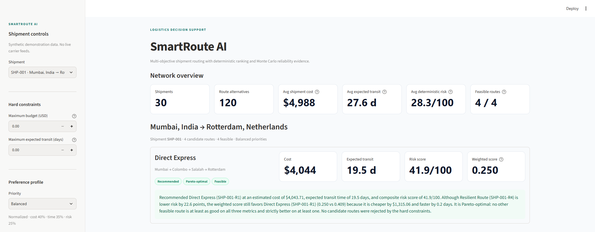
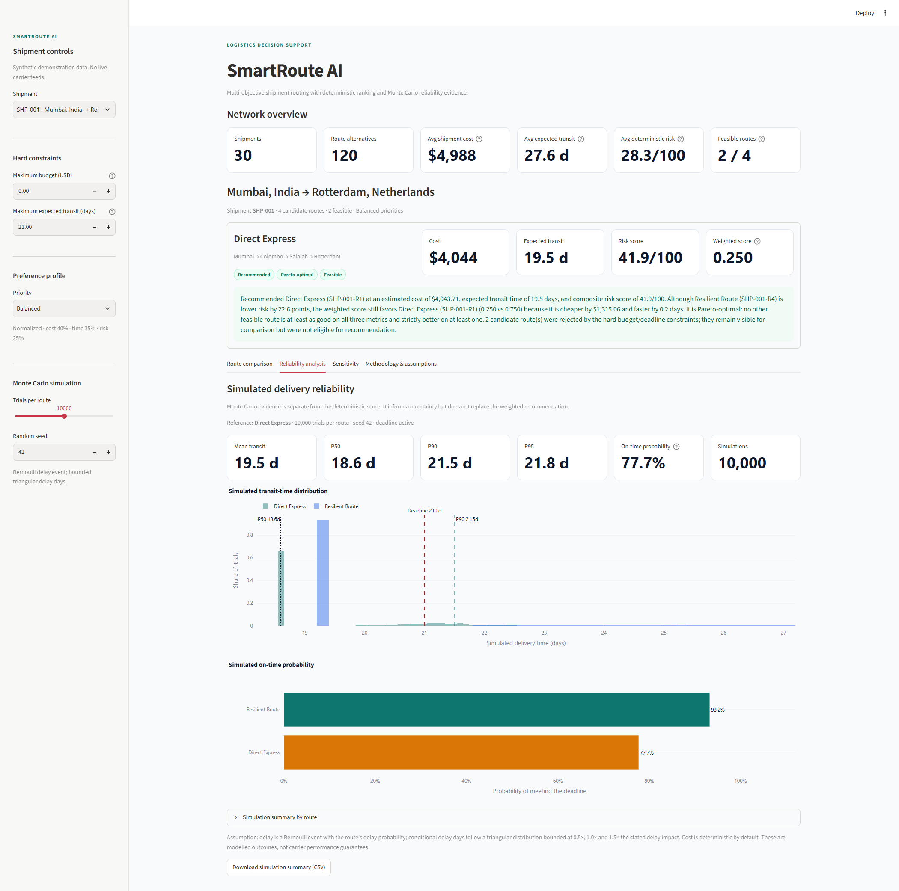
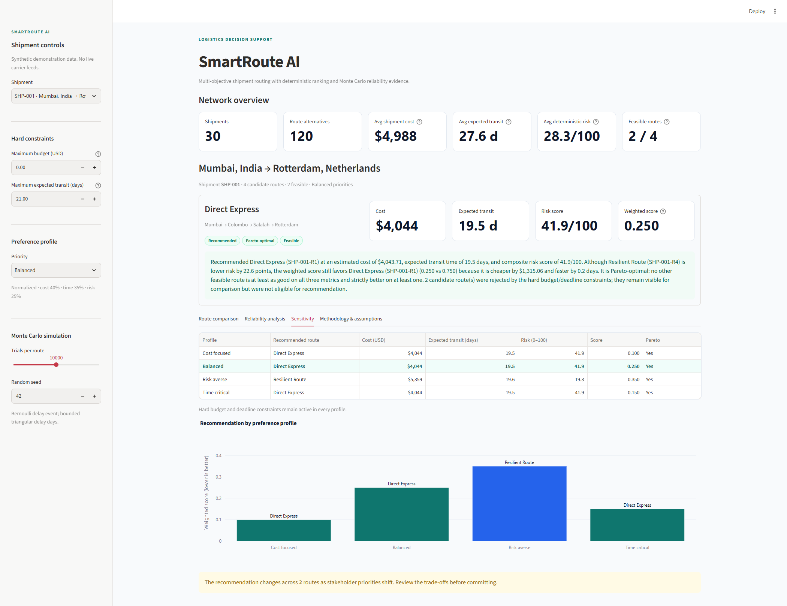

# SmartRoute AI

Explainable multi-objective shipment route optimization and decision support.

SmartRoute AI evaluates four candidate routes per shipment on transportation cost,
expected transit time, and composite operational risk. It applies hard budget and
delivery constraints, identifies the Pareto frontier, ranks feasible routes with
configurable preference weights, and explains each recommendation from the actual
evaluation results. A separate Monte Carlo layer adds delivery-time uncertainty,
on-time probability, and tail-risk evidence.

The deterministic weighted optimizer stays the primary recommendation mechanism.
Simulation never changes a route's score, rank, or constraint status.

[Technical report (PDF)](docs/SmartRoute_AI_Technical_Report.pdf) ·
[Screenshots](docs/screenshots/)

## Key features

- Expected transit time, composite risk, min-max normalization, and weighted ranking.
- Four preference profiles plus validated custom cost/time/risk weights.
- Hard budget and deadline constraints with infeasible-route exclusion.
- Pareto frontier and dynamic recommendation explanations.
- Reproducible Monte Carlo transit simulation with P50/P90/P95 and on-time probability.
- Interactive Streamlit dashboard with route comparison, reliability, sensitivity, and
  methodology tabs.
- CSV exports for route evaluations and simulation summaries.
- 110 automated tests for the optimizer, simulator, dataset, and Streamlit integration.

## Dashboard preview



The sidebar holds the shipment, hard constraints, preference profile, and simulation
settings. The recommendation card and the comparison tab update on every change.

| Reliability analysis | Sensitivity analysis |
|---|---|
|  |  |

The full capture set, including the constrained and no-feasible-route states, is in
[`docs/screenshots/`](docs/screenshots/):

| File | State shown |
|---|---|
| `01-overview.png` | Default shipment, no hard constraints |
| `02-shipment-controls.png` | Sidebar with a $5,200 budget and 24-day limit |
| `03-recommendation.png` | Recommendation under those constraints |
| `04-route-comparison.png` | Comparison table, feasible and infeasible routes |
| `05-reliability.png` | Monte Carlo results against a 21-day deadline |
| `06-sensitivity.png` | Recommendation across the four profiles |
| `07-no-feasible-route.png` | $1,000 budget, no feasible route |
| `route-comparison-table.png` | Table crop used in the technical report |

All screenshots were captured from the running Streamlit app in Edge at 2100 px width;
no values were retyped or mocked up.

## Problem definition

A shipment planner has several ways to move a shipment from origin to destination.
The options trade off differently:

- A faster route may cost more or carry higher operational risk.
- A cheaper route may be slower or less reliable.
- A safer route may require more time or budget.

The engine answers: **which feasible route best matches the planner's priorities,
which alternatives are Pareto-optimal, and why was this route selected?**

This is a decision-support prototype. It does not use machine learning, LLM
frameworks, live carrier feeds, or route-path generation. All dataset values are
synthetic and illustrative.

## Repository structure

```text
smartroute-ai/
├── app.py                     # Interactive Streamlit analytics dashboard
├── main.py                    # Command-line route evaluation
├── requirements.txt
├── README.md
├── REPORT_TEMPLATE.md         # Report source (completed)
├── .gitignore
├── data/
│   └── shipments.csv          # Generated and validated dataset
├── docs/
│   ├── SmartRoute_AI_Technical_Report.pdf
│   ├── report.html            # Print source for the report PDF
│   ├── DEMO_SCRIPT.md
│   └── screenshots/           # Screenshots captured from the running app
├── src/
│   ├── __init__.py
│   ├── data_generator.py      # Synthetic data + validation
│   ├── optimizer.py           # Metrics, constraints, ranking, Pareto, explanations
│   └── simulation.py          # Monte Carlo reliability engine
└── tests/
    ├── conftest.py
    ├── test_app.py            # Streamlit AppTest integration tests
    ├── test_data_generator.py
    ├── test_optimizer.py
    └── test_simulation.py
```

## Architecture

```text
data_generator ──> shipments.csv
                        │
          ┌─────────────┴──────────────┐
          ▼                            ▼
    optimizer.py                 simulation.py
    ranking, constraints,        simulated transit
    Pareto, explanations,        distributions,
    profile sensitivity          percentiles, on-time
          │                            │
          └─────────────┬──────────────┘
                        ▼
             app.py / main.py ──> decision support
```

`optimizer.py` and `simulation.py` are independent of Streamlit. The dashboard
consumes both, but simulation does not change optimizer scores or constraint
results.

## Dataset

The generator produces **30 unique shipments** and **4 candidate routes per
shipment**, for **120 route options** in total. The default seed is fixed at `42`,
so the dataset is reproducible.

Each record contains:

| Field | Meaning |
|---|---|
| `shipment_id` | Unique shipment identifier |
| `origin` | Origin city and country |
| `destination` | Destination city and country |
| `route_id` | Globally unique route identifier |
| `route_name` | Human-readable option name |
| `intermediate_hubs` | Hubs used by the option |
| `legs` | Ordered city sequence of the route |
| `cost_usd` | All-in illustrative transportation cost |
| `transit_days` | Scheduled transit time before delays |
| `delay_probability` | Probability-like delay indicator in [0, 1] |
| `delay_impact_days` | Extra days conditional on a delay |
| `congestion_risk` | Congestion indicator on a 0-100 scale |
| `geopolitical_risk` | Geopolitical indicator on a 0-100 scale |

### Generation assumptions

- Values are synthetic and illustrative, not live shipping-market information.
- One shipment has one origin and destination; its four options differ by cost,
  scheduled time, delay exposure, and risk inputs.
- The four option profiles are deliberately constructed to create trade-offs:
  faster/riskier, safer/slower/costlier, middle-ground, and expensive resilience.
- Delay probability, congestion, and geopolitical risk are assumed inputs, not
  predictions from trained models.
- The dataset generator is separate from the optimization engine.

### Validation rules

`validate_dataset()` raises one aggregated `ValueError` with the offending column
and example route IDs. It rejects:

- Missing required columns or an empty dataset.
- Missing values in required fields.
- Non-numeric cost, time, delay, or risk fields.
- Cost or scheduled transit time less than or equal to zero.
- Delay probability outside `[0, 1]`.
- Negative delay impact.
- Congestion or geopolitical risk outside `[0, 100]`.
- Duplicate `route_id` values or duplicate `(shipment_id, route_id)` pairs.
- A shipment whose origin equals its destination.
- A shipment with fewer than three route options.

## Methodology

### 1. Expected transit time

```text
Expected transit time = scheduled transit days
                        + (delay probability × delay impact days)
```

Example: `25 + (0.30 × 5) = 26.5` days.

The engine applies this consistently to every candidate route before constraints
and ranking.

### 2. Composite operational risk

```text
Risk score = 0.45 × delay probability × 100
           + 0.30 × congestion risk
           + 0.25 × geopolitical risk
```

The result is clipped to `[0, 100]`.

Why these factors:

- **Delay probability (45%)** is weighted highest because schedule uncertainty
  directly affects delivery commitments and downstream planning.
- **Congestion (30%)** captures operational variability at ports and corridors.
- **Geopolitical risk (25%)** captures disruption exposure that is important but
  less frequent and less directly observable.

The weights are currently module constants. A future version can make them
configurable per shipment type, trade lane, or risk policy. The score is a
**decision-support indicator**, not a statistically calibrated probability.

### 3. Min-max normalization

For each feasible route and each metric:

```text
X_normalized = (X - X_min) / (X_max - X_min)
```

- `0` is the best value among the shipment's feasible candidates.
- `1` is the worst value among the shipment's feasible candidates.
- If every candidate has the same value for a metric, all normalized values are
  `0`; no division by zero occurs.
- Normalization is relative to one shipment. Scores are not comparable across
  shipments.

### 4. Weighted scoring

```text
Score = cost weight × normalized cost
      + time weight × normalized expected time
      + risk weight × normalized risk
```

Lower is better. Weights are validated and automatically normalized to sum to 1.
Unknown keys, negative values, non-finite values, booleans, and an all-zero
weight set are rejected with clear errors.

Default weights:

| Objective | Weight |
|---|---:|
| Cost | 40% |
| Expected transit time | 35% |
| Operational risk | 25% |

Cost-focused, time-critical, risk-averse, balanced, and custom weights are all
supported. A zero weight is allowed as long as at least one weight is positive.

### 5. Hard constraints

- **Maximum budget:** `cost_usd <= max_budget`
- **Maximum expected transit time:** `expected_transit_days <= max_days`

Both limits are inclusive. A route that violates either limit is marked
infeasible, receives no score or rank, cannot be Pareto-optimal, and can never be
recommended. Infeasible routes remain visible in the comparison output with a
status explaining which limit was exceeded.

If no route satisfies the constraints, the engine returns a no-feasible-route
result with the counts excluded by budget and/or deadline, the cheapest and
fastest candidate values, and a suggestion to review the budget or delivery
deadline. It does not silently recommend an infeasible option.

### 6. Pareto optimality

Across cost, expected transit time, and risk score, a route is Pareto-optimal if
no other **feasible** route is at least as good on all three metrics and strictly
better on at least one.

- Identical routes do not dominate each other.
- An infeasible route cannot dominate a feasible route.
- Pareto analysis is computed only over feasible routes.
- Pareto optimality is not the same as weighted-score ranking. A route can have
  the lowest weighted score under a particular weight set without being
  Pareto-optimal. Both signals are reported separately.

### 7. Explainable recommendation

Explanations are generated dynamically from the evaluation table. They include:

- The selected route, cost, expected transit time, and risk score.
- The weighted score and its comparison with the next-best feasible route.
- Which metrics favor the recommendation and which favor the alternative.
- Whether the selected route is Pareto-optimal.
- How many alternatives were rejected by hard constraints.

The wording adjusts to the actual data. For example, it correctly says the
recommendation is cheaper, faster, slower, more expensive, safer, or riskier when
that is what the comparison shows.

### 8. Monte Carlo reliability simulation

`src/simulation.py` adds a separate, reproducible uncertainty layer. It does not
change the deterministic ranking or the meaning of the risk score.

For every route and every trial:

1. Start with the scheduled transit time.
2. Draw a Bernoulli delay event using `delay_probability`.
3. If delayed, draw extra days from a bounded triangular distribution:
   - lower bound: `0.5 × delay_impact_days`
   - mode: `delay_impact_days`
   - upper bound: `1.5 × delay_impact_days`
4. Add the delay to the scheduled time and record the outcome.

The triangular distribution is an explicit **modelling assumption**, not a
measured carrier distribution. Zero delay impact adds no days. Zero delay
probability produces no delay events; a probability of one produces a delay event
in every trial.

The simulator reports, per route:

| Output | Meaning |
|---|---|
| `mean_transit_days` | Mean simulated delivery time |
| `median_transit_days` | P50 simulated delivery time |
| `p90_transit_days` | P90 simulated delivery time |
| `p95_transit_days` | P95 simulated delivery time |
| `on_time_probability` | Share of trials at or below the selected deadline |
| `mean_cost` | Mean simulated cost |
| `probability_over_budget` | Available only when optional cost uncertainty and a budget are enabled |
| `simulation_count` | Trials per route |

Defaults are **10,000 trials per route** and **seed 42**. Each route gets an
independent random stream derived from the seed, so results are reproducible and
do not depend on global random state. The input DataFrame is never mutated.
Invalid simulation counts, seeds, probabilities, missing columns, and non-finite
inputs are rejected with clear errors.

If no deadline is supplied, `on_time_probability` is `NaN` and the dashboard says
that the metric is unavailable. Cost is deterministic by default. Optional cost
uncertainty is exposed through the engine API as a coefficient of variation; the
dashboard keeps it off because the dataset does not justify a cost-variability
assumption.

Primary API:

```python
from simulation import simulate_routes

result = simulate_routes(
    shipment_routes,
    n_simulations=10_000,
    seed=42,
    deadline=30.0,
)
result.summary   # one row per route
result.samples   # long-form trial outcomes
```

### 9. Sensitivity analysis

The same shipment is evaluated under four preference profiles:

| Profile | Cost | Time | Risk |
|---|---:|---:|---:|
| Cost focused | 70% | 20% | 10% |
| Balanced | 40% | 35% | 25% |
| Risk averse | 15% | 20% | 65% |
| Time critical | 15% | 70% | 15% |

Hard constraints are respected in every profile. If the recommended route changes
across profiles, the decision is sensitive to stakeholder priorities.

## Interactive dashboard

`app.py` is a four-tab logistics analytics workspace built with Streamlit, Pandas,
NumPy, and Plotly. It uses actual calculated dataset values; no dashboard metrics
or chart points are hardcoded.

### Sections

- **Network overview:** total shipments, route alternatives, average shipment
  cost, average expected transit time, average deterministic risk, and feasible
  routes for the selected shipment.
- **Shipment controls (sidebar):** shipment selection, optional budget and
  deadline, the four built-in preference profiles, custom cost/time/risk weights,
  simulation count, and random seed.
- **Recommended route:** route name, legs, cost, expected transit time, risk score,
  weighted score, Pareto status, feasibility, and the optimizer's dynamic
  explanation. Infeasible routes are never recommended.
- **Route comparison:** sortable table with cost, expected transit, risk, score,
  rank, Pareto status, feasibility, and constraint status. The recommendation is
  highlighted and infeasible rows are visually muted.
- **Reliability analysis:** mean transit, P50, P90, P95, on-time probability, and
  simulation count for the recommended (or reference) route, plus a transit-time
  distribution and an on-time probability comparison.
- **Sensitivity:** the recommendation under all four preference profiles, with
  cost, time, risk, score, Pareto status, and a profile-comparison chart. Hard
  constraints remain active in every profile.
- **Methodology and assumptions:** expandable explanations of normalization,
  weighted scoring, constraints, Pareto dominance, the Monte Carlo model, and
  dataset limitations.

### Charts

1. Cost vs expected transit time, distinguishing feasible, infeasible, Pareto, and
   recommended routes.
2. Deterministic risk comparison across alternatives.
3. Weighted optimization ranking.
4. Simulated transit-time distribution with P50, P90, and deadline markers.
5. Simulated on-time probability across feasible routes.
6. Recommendation sensitivity across preference profiles.

The dashboard validates weights, catches simulation and evaluation errors, handles
no-data and no-feasible-route states, and never presents an infeasible option as a
recommendation. It also offers CSV downloads for route evaluation and simulation
summary.

## Installation

Python 3.10 or newer is required. If Python is not installed, get it from
[python.org](https://www.python.org/downloads/) or run `winget install Python.Python.3.12`
in PowerShell. On Windows, tick **Add python.exe to PATH** in the installer.

Windows PowerShell:

```powershell
python -m venv .venv
.venv\Scripts\Activate.ps1
python -m pip install --upgrade pip
python -m pip install -r requirements.txt
```

If PowerShell blocks the activation script, run
`Set-ExecutionPolicy -Scope Process -ExecutionPolicy Bypass` for the current session.

macOS/Linux:

```bash
python3 -m venv .venv
source .venv/bin/activate
python -m pip install -r requirements.txt
```

## Execution

Run the interactive Streamlit dashboard:

```bash
streamlit run app.py
```

It opens at `http://localhost:8501` with the full dataset loaded, the first shipment
selected, no hard constraints, the Balanced profile, and 10,000 simulation trials.

Run the command-line evaluation:

```bash
python main.py
```

The CLI prompts for a shipment ID, ranks that shipment's routes with the Balanced
weights, and prints the comparison table plus the explanation. Hard constraints and
profile selection are dashboard features.

Regenerate the validated dataset (only needed if `data/shipments.csv` is deleted or
the generator changes):

```bash
python -m src.data_generator
```

## Technical report

The two-to-three page technical report is
[`docs/SmartRoute_AI_Technical_Report.pdf`](docs/SmartRoute_AI_Technical_Report.pdf).
Its Markdown source is [`REPORT_TEMPLATE.md`](REPORT_TEMPLATE.md), the print layout is
[`docs/report.html`](docs/report.html), and


## Example workflow

1. Start the dashboard and select a shipment.
2. Review the recommendation and its explanation under the Balanced profile.
3. Set a maximum budget and a maximum expected transit time.
4. Compare feasible alternatives in the route comparison tab. If no route is
   feasible, relax a constraint rather than selecting an infeasible route.
5. Open the reliability tab. Set a deadline if on-time probability is needed, then
   inspect P50/P90/P95 and the simulated distribution against that deadline.
6. Open the sensitivity tab to see whether cost-, risk-, or time-focused priorities
   change the recommendation.
7. Download the route evaluation and simulation summary for review.

## Example output

`python main.py`, entered `SHP-001`, dataset unchanged, Balanced weights:

```text
Shipment ID (e.g. SHP-001): SHP-001
 rank       route_name  cost_usd  expected_transit_days  risk_score    score  feasible
    1   Direct Express   4043.71                19.4736      41.885 0.250000      True
    2  Resilient Route   5358.77                19.6432      19.300 0.409356      True
    3 Economy Corridor   4732.31                22.9946      34.380 0.570602      True
    4     Regional Hub   4830.55                25.8185      25.870 0.662057      True

Recommended Direct Express (SHP-001-R1) at an estimated cost of $4,043.71,
expected transit time of 19.5 days, and composite risk score of 41.9/100.
Although Resilient Route (SHP-001-R4) is lower risk by 22.6 points, the weighted
score still favors Direct Express (SHP-001-R1) (0.250 vs 0.409) because it is
cheaper by $1,315.06 and faster by 0.2 days. It is Pareto-optimal: no other
feasible route is at least as good on all three metrics and strictly better on at
least one. No candidate routes were rejected by the hard constraints.
```

The explanation is generated from the evaluation table, so the wording changes with
the data. It is not a static template.

## Testing

```bash
pytest -q
```

With warnings treated as errors (the command used for the submission check):

```bash
python -W error -m pytest -q
```

Current result: **110 passed** on Python 3.12.10 with pandas 3.1.1, NumPy 2.5.4,
Streamlit 1.67.0, and Plotly 7.1.0.

The suite covers dataset generation and reproducibility, field and range
validation, duplicate IDs and duplicate shipment-route pairs, missing columns,
expected transit time, risk score, weight normalization, invalid and negative
weights, min-max normalization, identical metric values, weighted ranking, budget
and deadline constraints, boundary conditions, no-feasible-route results,
Pareto-optimal and dominated routes, equal metrics, dynamic explanation
consistency, constraint rejection reporting, sensitivity analysis, and empty or
missing input guards.

Monte Carlo tests cover trial counts, seed reproducibility, different-seed
divergence, input immutability, zero and certain delay probabilities, zero delay
impact, on-time probability bounds, percentile ordering, physical validity,
independent route simulation, invalid counts/seeds/probabilities/deadlines/budgets,
missing columns and deadlines, empty results, optional cost uncertainty, and
integration with the existing optimizer.

Streamlit `AppTest` covers the rendered dashboard, no-feasible-route handling,
deadline-enabled on-time metrics, and invalid custom-weight validation.

Headless startup smoke test:

```bash
streamlit run app.py --server.headless true --server.port 8501
```

## Limitations

- All synthetic data is illustrative and is **not** based on live shipping-market
  information, carrier quotations, or real-time risk intelligence.
- Risk weights are fixed constants; they are documented but not yet user-editable
  through a configuration file.
- Delay probability is an input indicator, not a calibrated forecast.
- Monte Carlo delay days use a bounded triangular assumption around
  `delay_impact_days`; this is a scenario model, not an empirically fitted
  distribution.
- Cost is deterministic in the dashboard. The optional cost-uncertainty API is not
  used because the synthetic dataset does not provide a defensible cost-variation
  estimate.
- On-time probability depends on the planner's selected deadline and the stated
  simulation assumptions; it is not a carrier service guarantee.
- The dashboard evaluates one shipment at a time; it does not optimize a fleet or
  allocate shared capacity.
- Min-max normalization makes scores relative to one shipment's feasible options.
- A weighted sum can hide trade-offs; Pareto analysis and sensitivity profiles are
  included to make those trade-offs visible.
- The engine assumes candidate routes already exist. It does not compute maritime
  paths, vessel schedules, port calls, customs costs, emissions, or live weather.
- There is no database, authentication, or persistence layer; settings reset when
  the session ends.
- Production use requires calibrated data, provenance and freshness metadata,
  operational constraints, monitoring, and human review.

## Verification summary

Environment: Python 3.12.10 (`.venv312`), pandas 3.1.1, NumPy 2.5.4, Streamlit 1.67.0,
Plotly 7.1.0. Dependencies install from `requirements.txt` in a clean virtual
environment.

- Dataset: 30 shipments, 4 routes each, 120 unique route options, seed 42.
- `python -W error -m pytest -q`: 110 passed.
- `python -m py_compile app.py main.py src/*.py`: no syntax errors.
- `streamlit run app.py --server.headless true`: starts and answers `/_stcore/health`.
- Regenerating the dataset reproduces `data/shipments.csv` byte for byte, and every
  record passes validation.
- Monte Carlo results are reproducible for a fixed seed and do not mutate inputs.
- Infeasible routes are never recommended, including under every preference profile.
- Recommendation explanations are derived from the actual ranking and comparison
  values.
- The dashboard renders headlessly without application exceptions and is covered by
  `AppTest` integration checks.

Submission documents:

- [`docs/SmartRoute_AI_Technical_Report.pdf`](docs/SmartRoute_AI_Technical_Report.pdf)
- [`docs/screenshots/`](docs/screenshots/)
