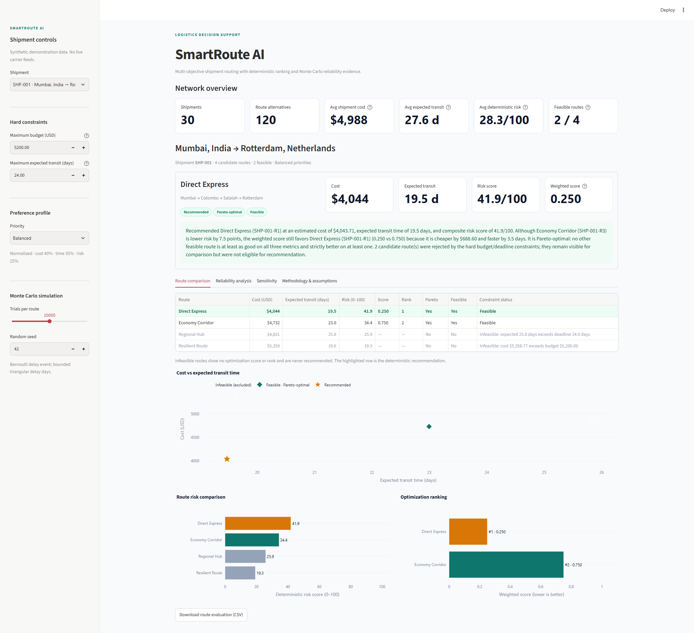

# SmartRoute AI: Shipment Route Optimization Under Cost, Time and Risk Constraints

Technical report · SmartRoute AI · November 2026

## 1. Problem statement

A shipment between two hubs usually has more than one viable routing: a direct service,
regional consolidation, an economy corridor, or a costlier resilient option. The options
trade off against each other. A faster route can cost more and carry higher delay
exposure. A cheaper route can be slower or riskier. A safer route can consume budget or
calendar time the shipment does not have.

Choosing the lowest freight cost alone ignores commitments that are often more expensive
to break than the freight bill: a late delivery, an unreliable corridor, or a route whose
risk is concentrated in one congested port. Planners therefore compare alternatives on
several objectives at once, under a budget and a delivery target, and need to explain the
choice to someone else.

SmartRoute AI is a decision-support prototype for that comparison. Given one shipment's
candidate routes and a planner's priorities, it answers two linked questions:

1. Which route is feasible and best matches the weighted priorities?
2. How uncertain is that route's delivery time under an explicit delay model?

The scope is deliberately narrow: evaluate existing route options for one shipment at a
time. The project does not generate maritime paths, price real freight, or predict risk
from live data.

## 2. Proposed solution

The deterministic optimizer (`src/optimizer.py`) computes three objective values per
route, removes routes that violate hard constraints, normalizes the remaining metrics,
and ranks them with stakeholder weights. Pareto analysis runs on the same feasible set so
the planner sees whether the winner is genuinely non-dominated. A separate Monte Carlo
engine (`src/simulation.py`) provides reliability evidence and never alters scores, ranks,
or constraint outcomes. The Streamlit dashboard (`app.py`) and the CLI (`main.py`) are
thin clients over those two modules.

```text
Shipment data → Validation → Feature calculation → Constraint filtering
             → Weighted optimization → Pareto analysis → Recommendation
                                        ↘ Monte Carlo reliability (separate branch)
```

`src/data_generator.py` produces and validates the synthetic dataset once; both clients
read the same CSV, so figures in this report can be reproduced from the repository.

## 3. Technical stack

| Technology | Role in this project |
|---|---|
| Python 3.12 | Implementation language for the optimizer, simulator, and clients |
| pandas | Tabular dataset, validation, ranking, summary statistics |
| NumPy | Vectorized trial generation and percentile estimation |
| Streamlit | Four-tab interactive dashboard and `AppTest` integration tests |
| Plotly | Six chart types (scatter, two bar charts, histogram, on-time bars, profile bars) |
| pytest | 110 tests covering formulas, constraints, simulation, and the dashboard |

No machine-learning framework, database, or external API is used. The dependency list is
five packages (`requirements.txt`); the project runs offline once installed.

## 4. Expected transit time

The optimizer adds expected delay to the scheduled transit time of each route:

```text
expected_transit_days = transit_days + delay_probability × delay_impact_days
```

`delay_probability` is the assumed chance that the route is delayed at all;
`delay_impact_days` is the assumed length of that delay. For `SHP-001-R1`
(Direct Express): `18.6 + 0.336 × 2.6 = 19.47` days, displayed as 19.5.

This is a first-moment estimate. It is used for constraint filtering and ranking; the
distribution around it is handled only by the simulation layer.

## 5. Risk calculation

Composite operational risk is a 0–100 indicator:

```text
risk_score = 0.45 × delay_probability × 100
           + 0.30 × congestion_risk
           + 0.25 × geopolitical_risk          (clipped to [0, 100])
```

For `SHP-001-R1`: `0.45 × 33.6 + 0.30 × 76.3 + 0.25 × 15.5 = 41.9`.

Delay probability receives the largest weight because schedule uncertainty directly
affects delivery commitments. Congestion is next because it drives variability at ports
and corridors. Geopolitical exposure is weighted lowest because it is rarer and less
directly observable. The weights are module constants. The score is a decision-support
index, not a probability of failure, and it is not calibrated against historical events.

## 6. Multi-objective optimization

**Min-max normalization.** Within one shipment's feasible set, each metric becomes
`(value − min) / (max − min)`. The best route scores 0 and the worst scores 1. If every
route shares the same value, all normalized values are 0; the implementation divides only
when `max > min`, so equal metrics never produce a division by zero or a `NaN`.

**Weighted score.** `score = w_cost·cost_norm + w_time·time_norm + w_risk·risk_norm`.
Lower is better. Input weights are validated (numeric, finite, non-negative, known keys,
at least one positive value) and normalized to sum to 1. The default Balanced profile is
40% cost, 35% time, 25% risk. The other profiles are Cost focused (70/20/10), Risk averse
(15/20/65), and Time critical (15/70/15). Custom weights are allowed if they pass the same
validation.

**Hard constraints.** A route is feasible only if `cost_usd ≤ budget` and
`expected_transit_days ≤ deadline`; both limits are inclusive and either may be disabled.
Infeasible routes stay visible for comparison but receive no score, no rank, no Pareto
status, and can never be recommended. If nothing is feasible, the application reports how
many routes failed each constraint, the cheapest cost and fastest time available, and
which limit to review. It does not fall back to an infeasible option.

**Ranking and ties.** Feasible routes are sorted by score, then by cost. Equal scores are
ranked with `method="first"`, a deterministic tie-break that keeps output stable across
runs.

**Pareto optimality.** Among feasible routes, a route is Pareto-optimal if no other route
is at least as good on cost, expected time, and risk and strictly better on at least one.
Identical routes do not dominate each other. Pareto status and weighted rank answer
different questions and are reported separately: a weighted winner can be dominated when
the weights heavily favour one objective.

## 7. Monte Carlo simulation

For each route and trial: start from the scheduled transit time, draw a Bernoulli delay
event with the route's `delay_probability`, and if delayed add extra days from a bounded
triangular distribution with lower bound `0.5 × delay_impact_days`, mode
`delay_impact_days`, and upper bound `1.5 × delay_impact_days`. The default is 10,000
trials per route with seed 42.

The **triangular delay distribution is a modelling assumption, not an empirically fitted
carrier distribution**. It encodes "delays are usually near the stated impact, rarely much
longer", and it should be replaced with historical data before operational use. Zero delay
impact adds no days; a probability of 0 produces no events and a probability of 1 delays
every trial.

Each route gets an independent random stream spawned from the seed, so results are
reproducible and do not depend on global random state. The input frame is not mutated.

| Output | Meaning |
|---|---|
| `mean_transit_days` | Mean simulated delivery time |
| `median_transit_days` | P50 simulated delivery time |
| `p90_transit_days`, `p95_transit_days` | Tail percentiles |
| `on_time_probability` | Share of trials at or below the selected deadline (NaN without one) |
| `mean_cost` | Mean simulated cost; deterministic unless cost uncertainty is enabled via the API |
| `simulation_count` | Trials per route |

Cost is deterministic in the dashboard. The optional lognormal cost-variation parameter
exists in the engine API but is not exposed, because the synthetic dataset provides no
defensible estimate of cost variability.

## 8. Experimental results

All figures below come from the repository dataset and code, not from separate estimates.

**Dataset and configuration.** 30 shipments, 4 candidate routes each, 120 route options,
generated with seed 42 and validated before use. Average of each shipment's cheapest
option: $4,987.84. Mean expected transit across all options: 27.6 days. Mean risk:
28.3/100. Without hard constraints, 22 of 30 shipments have all four options on the Pareto
frontier, 7 have three, and 1 has two.

**Representative shipment: SHP-001, Mumbai → Rotterdam** (Balanced profile, no
constraints). All four routes are feasible and Pareto-optimal, so the choice is decided by
weights alone:

| Route | Cost | Expected transit | Risk | Score | Rank |
|---|---:|---:|---:|---:|---:|
| Direct Express | $4,043.71 | 19.5 d | 41.9 | 0.250 | 1 |
| Resilient Route | $5,358.77 | 19.6 d | 19.3 | 0.409 | 2 |
| Economy Corridor | $4,732.31 | 23.0 d | 34.4 | 0.571 | 3 |
| Regional Hub | $4,830.55 | 25.8 d | 25.9 | 0.662 | 4 |

Direct Express wins because it is the cheapest and fastest; its high risk costs it the
full 0.25 risk weight, but Resilient Route's 22.6-point risk advantage cannot recover the
$1,315.06 price gap under 40% cost weight.

**Constraints.** With a $5,200 budget and a 24-day expected-transit limit, the feasible set
shrinks to Direct Express and Economy Corridor. Resilient Route fails the budget
($5,358.77) and Regional Hub fails the deadline (25.8 d). Direct Express keeps rank 1 with
a score of 0.250 against 0.750. With a $1,000 budget every route fails, the dashboard
reports `0 / 4` feasible, and the explanation names the budget as the binding constraint.

**Monte Carlo reliability** (10,000 trials per route, seed 42, deadline 21 days):

| Route | Mean | P50 | P90 | P95 | On-time |
|---|---:|---:|---:|---:|---:|
| Direct Express | 19.5 d | 18.6 d | 21.5 d | 21.8 d | 77.7% |
| Resilient Route | 19.7 d | 19.3 d | 19.3 d | 23.9 d | 93.2% |
| Economy Corridor | 23.0 d | 20.7 d | 29.0 d | 29.9 d | 70.5% |
| Regional Hub | 25.8 d | 24.9 d | 30.1 d | 31.0 d | 0.0% |

This is the case where the deterministic winner is not the most reliable. Direct Express
delays often (33.6% of trials) but briefly, so its tail is thin. Resilient Route delays
rarely (6.6%) but for longer when it does, which is why its P50 equals its scheduled time
while its P95 is 23.9 days. At a 21-day deadline the cheap route misses 22.3% of the time
and the expensive route 6.8%. A planner who cares about the commitment more than the
freight bill would choose differently, and the dashboard shows that trade-off rather than
hiding it in a single score.

**Sensitivity.** Under the same 21-day deadline, Cost focused, Balanced, and Time critical
all keep Direct Express (scores 0.100, 0.250, 0.150), while Risk averse switches to
Resilient Route (0.350). The dashboard states whether the recommendation is stable or
changes across profiles. Hard constraints are applied in every profile.

**Verification.** `python -W error -m pytest -q` reports 110 passed on Python 3.12.10 with
warnings treated as errors. The dashboard was exercised through Streamlit `AppTest` and
captured from a headless Edge session at 2100 px width.



## 9. Limitations

- **Synthetic data.** All costs, transit times, delay probabilities, congestion, and
  geopolitical values are generated for demonstration. They are not quotations or risk
  intelligence.
- **Assumed delay model.** The Bernoulli/triangular construction is a stated assumption.
  It has not been calibrated against carrier performance.
- **Deterministic cost.** Cost does not vary across trials in the dashboard, so
  `probability_over_budget` is not shown.
- **No live integration.** There are no carrier, weather, port, customs, or market feeds.
- **Single-shipment scope.** The optimizer evaluates one shipment's alternatives. It does
  not allocate fleet capacity or shared inventory across shipments.
- **Relative scores.** Min-max normalization is computed per shipment, so scores are not
  comparable between shipments.
- **Weighted sums hide trade-offs.** Pareto analysis and the four profiles exist to make
  those trade-offs visible, but the underlying weights remain a human judgement.
- **Fixed risk weights.** The 45/30/25 split is documented, not configurable per lane or
  policy.
- **No persistence or authentication.** Settings reset with the session.
- **No predictive accuracy claim.** Nothing in the project validates that the risk score
  predicts real disruptions.

## 10. Conclusion and future improvements

The implementation currently delivers a working, tested, reproducible prototype:
validated synthetic data, an explainable weighted optimizer with hard constraints and
Pareto analysis, a reproducible Monte Carlo layer with tail metrics, a four-tab dashboard,
a CLI, and 110 automated tests. Every number in this report can be regenerated from the
repository with the documented commands.

Production work would start with data, not features. The highest-value next steps are:

1. Replace synthetic inputs with historical shipment records and calibrate the delay
   distribution and risk weights from them.
2. Connect live carrier, port, and weather feeds with provenance and freshness metadata.
3. Extend optimization from one shipment to fleet-level allocation under shared capacity.
4. Train and validate a delay-prediction model, and only then treat risk as predictive.
5. Persist decisions, monitor outcomes, and add a human approval workflow.

None of these are implemented today. They are the path from a decision-support prototype
to an operational system.

## 11. Reproducibility

```bash
python -m venv .venv
.venv\Scripts\Activate.ps1          # Windows PowerShell
python -m pip install -r requirements.txt

python -W error -m pytest -q        # 110 passed
python main.py                      # CLI: enter SHP-001
streamlit run app.py                # dashboard at http://localhost:8501
```

Package versions used for the reported runs are listed in `requirements.txt` and the
README; the dataset regenerates identically from seed 42 with
`python -m src.data_generator`.
